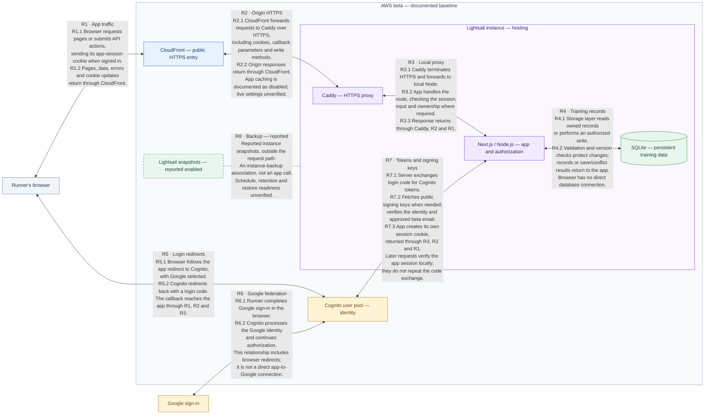
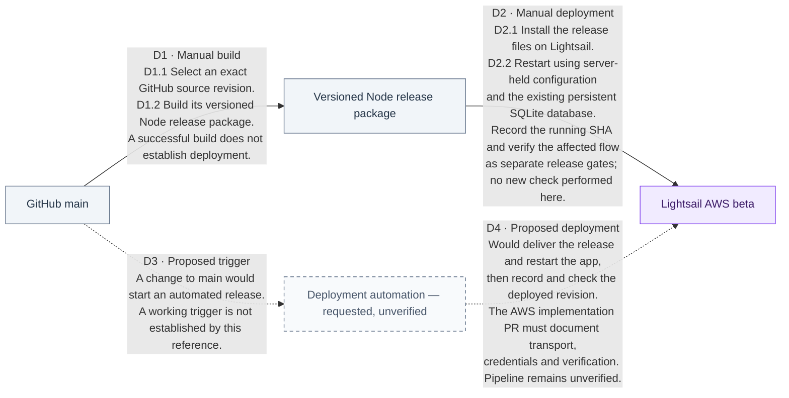

# Forrest Runs architecture

Last reviewed: **2026-11-19 (America/Chicago)**.
Owner: the agent implementing an architecture-affecting change; Hieu reviews the change.

This is the project's current architecture reference. It describes service
relationships and hosting boundaries, rather than every application screen or
library. Keep the current deployment separate from proposed changes.

## Evidence and deployment status

- Source inspected: GitHub main `b8dbc7bc1e2690a21bf4ac6b32b1d381aac66394`.
- Hieu reported updating AWS beta with the latest merged UI on 2026-11-19.
  This documentation task did not inspect the running server's release SHA or
  AWS resource configuration. Treat service placement below as the documented
  operational baseline, not a fresh AWS inventory audit.
- CloudFront, Lightsail/Caddy, and Cognito/Google were configured and live
  Google sign-in was previously reported working. Instance snapshots were
  reported enabled; their current schedule, retention and restore readiness
  have not been checked for this document.
- The repository's Node/Cognito adapters establish the app, storage and sign-in
  behavior. Older planning sections in ENVIRONMENTS.md and NODE_RUNTIME_PROOF.md
  predate the live beta; they are historical context, not current deployment status.
- GitHub-to-AWS automation has been requested in the AWS chat. No workflow
  exists in the inspected main tree; a running automatic pipeline is not
  established by this review.

## Diagram conventions

Read diagrams from left to right. Keep runtime and deployment in separate views;
split a growing view into focused diagrams instead of adding an unreadably long row.

| Color | Component purpose |
| --- | --- |
| Blue | Networking and HTTPS entry |
| Purple | Hosting, app processes and request handling |
| Amber | Identity and sign-in, including the external Google provider |
| Green | Persistent data and backups |
| Slate | Browser, source control and release artifacts |

Color identifies purpose, not deployment status. Boundaries show where services
live; labels and dashed connections/borders identify reported, proposed or
unverified items. These status cues remain readable without distinguishing colors.

Each connection has a stable numbered reference: **R1–R8** for runtime and
**D1–D4** for deployment. The numbered explanation is embedded directly on each
connection; expand or zoom the diagram to read its activities without a table lookup.
References identify connections, not a universal execution order. A request can
reuse a connection, and sign-in, ordinary app traffic and backups follow different
paths. Substeps such as **R7.1–R7.3** explain several activities on one connection.
Preserve existing references when adding connections; assign new IDs rather than
renumbering unaffected links. Double-headed arrows include requests and responses.

## AWS beta: service relationships

Solid connections describe the documented running relationships. The dotted
backup connection and dashed snapshot border record a reported operational
setting that needs current verification. The backup line is an association with
the whole Lightsail instance, not an app-triggered backup operation. Arrows show
interaction, not a packet-level authentication sequence.

| Component | Responsibility |
| --- | --- |
| Runner's browser | Displays the React/TypeScript UI, sends app requests and follows sign-in redirects. |
| Amazon CloudFront | Public HTTPS entry point forwarding the app's requests to the Lightsail origin. The documented app behavior uses CachingDisabled and forwards the cookies, headers, query strings and methods needed by authentication and writes. |
| Amazon Lightsail | Linux host for the reverse proxy, app process and persistent SQLite file. The documented origin is IPv6-only. |
| Caddy | Terminates origin HTTPS and proxies requests to the local Node app. |
| Next.js / Node.js | Serves the UI and backend routes; validates input, verifies sessions, enforces approved-beta access, account ownership and optimistic concurrency. |
| SQLite / Drizzle | Stores users' training blocks, prescriptions, results and saved generation data on the host's disk through the existing store boundary and versioned migrations. |
| Amazon Cognito user pool | Federates Google sign-in and issues the identity token verified by the app. |
| Google | External identity provider. It is outside the AWS boundary. |
| Lightsail snapshots | Reported instance backup mechanism. Keep backup policy and restore verification distinct from simply having snapshots enabled. |

The proxy, app and SQLite database occupy the **same Lightsail instance**.
Cognito and CloudFront are separate managed services. The app has a single-host
compute/storage failure boundary; this diagram does not claim high availability.

### Sign-in and data access

1. After the initial app request through **R1–R3**, the app redirects the browser
   to Cognito's authorization endpoint with Google selected (**R5**).
2. Google authentication returns through Cognito (**R6**). Cognito redirects the
   browser to the app's `/auth/callback` (**R5**), reached through **R1–R3**.
3. The server exchanges the authorization code with Cognito, verifies the
   returned ID token using Cognito's public signing keys, and checks the verified
   Google identity against the approved-email list (**R7**).
4. The app issues its own secure, HttpOnly session cookie, returned through
   **R3 → R2 → R1**. Later requests use that signed session; the server checks
   access before reading or writing each user's records through **R4**.

The Cognito user pool subject anchors ownership. Google credentials are
configured in Cognito; the Cognito app-client secret and app-session secret are
server-side deployment configuration. Do not put credential values in this file.

In the inspected AWS/Node adapter, generation is **simulation-only**.
There is no live OpenAI API dependency in the current beta runtime.

## Environments and delivery

| Environment | Hosting / identity / storage | Relationship |
| --- | --- | --- |
| Local QA | Disposable Node/SQLite or Worker/Miniflare builds; synthetic users | Tests a specified source revision; isolated from live records. |
| ChatGPT Site staging | Sites runtime with Cloudflare Workers/D1 and managed ChatGPT sign-in | Separate hosting, identity and database from AWS. It has also held Hieu's real records, so the staging label alone does not make destructive testing safe. |
| AWS beta / UAT | CloudFront, Lightsail/Caddy/Next.js/SQLite, Cognito with Google | Separate beta accounts and data. Deploy an identified release and verify it there. |
| Future production | Not established by this review | Record its actual services and separate data/secrets when implemented. |

### Current release path and requested automation

The solid route is the documented manual release method. The dotted route is
requested future work, not an implemented pipeline or a choice of CI provider.
A merge, release build, deployment and post-deployment verification are distinct
events. Record their status separately.

The ChatGPT Site uses different runtime/auth/storage adapters. It is not an
intermediate server that copies its database or whole deployed source tree into
AWS. Both environments should integrate the approved feature source while
preserving their platform adapters and separate data.

## Keeping this reference current

For every PR, record **Architecture impact: changed / no change**, with one
sentence explaining the result.

Update this document in the same PR when a change affects services, hosting,
network routes, identity/access boundaries, data location, backups, secrets
placement, deployment automation or external integrations.

- The implementing agent owns the diagram and component-inventory update.
- Keep the current deployed diagram accurate. Put an approved but undeployed
  design in a clearly labeled proposed section; do not silently promote it to
  current because code merged.
- At deployment, record the environment, exact release SHA, verification date,
  and safe smoke-check evidence in the release/PR record. Update this document's
  deployment evidence when it changes the recorded architecture/status.
- Explain why a service or connection changed and its cost/data/security impact.
  New paid resources still require Hieu's existing cost approval.
- UI-only layout, color and branding changes normally need no diagram redraw.
- Review diagrams and links as documentation. Do not provision resources, run
  paid API calls, or repeat application-wide browser QA solely to edit this file.
- Read this file from the current repository in each feature/AWS chat. Chat
  names and conversation memory do not synchronize architecture records.

## Source references

- [Cognito adapter](../runtime/cognito.ts): redirects, code exchange, token
  verification, beta approval and app sessions.
- [Node runtime adapter](../runtime/node.ts): SQLite, identity and simulation mode.
- [SQLite adapter](../runtime/sqlite.mjs): local persistence and migrations.
- [Node runtime and beta configuration](../NODE_RUNTIME_PROOF.md): adapter setup
  and CloudFront behavior; its earlier provisioning checklist is historical.
- [AWS Cognito federation endpoints](https://docs.aws.amazon.com/cognito/latest/developerguide/federation-endpoints.html):
  browser authorization, app token exchange and public signing keys.

## Change log

| Date | Change | Status |
| --- | --- | --- |
| 2026-11-19 | Establish AWS beta topology, environment boundaries and architecture-maintenance rule. | Documentation prepared from repository source and deployment reports; live AWS configuration not re-audited. |
| 2026-11-19 | Reorient runtime and deployment views horizontally and add a shared color key for component roles, retaining explicit status labels. | Documentation presentation only; no service, deployment or infrastructure change. |
| 2026-11-19 | Number every runtime and deployment connection, explain multi-activity connections with substeps, and cross-reference the sign-in walkthrough. | Documentation explanation only; deployment and verification status unchanged. |
| 2026-11-19 | Embed numbered activity descriptions directly on every runtime and deployment connection using multiline labels; remove duplicate connection tables. | Documentation presentation only; horizontal layout, colors and deployment evidence preserved. |
