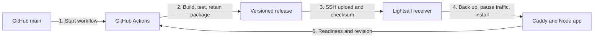

# Automatic deployment to the shared AWS app

## Scope and acceptance

This workflow builds the Node/SQLite AWS adapter after every push to GitHub
`main`, tests synthetic account ownership, saving/reloading, simulation and
Cognito callback handling, then deploys the exact tested package. Pull requests
run the same build and tests without receiving deployment credentials.

Only the newest `main` revision can deploy. Deployments are serialized in GitHub
and on the server. A successful upload alone does not count as deployment: the
receiver checks startup, the package's build identity, sign-in redirect and the
running revision, then GitHub checks the public HTTPS page. Real Google sign-in
and desktop/physical-phone UX remain human acceptance checks after relevant
changes. The runtime continues using simulated AI generation.

The destination is the existing shared beta/live instance at `3.132.106.53`.
There is one live AWS database. The pipeline does not create a production
instance, S3 bucket, paid runner, or OpenAI requests. GitHub-hosted Linux compute
and retained artifacts consume the account's included allowances; excess usage
can incur charges. Set GitHub spending controls in the account billing settings.

## Architecture impact

Approved design: dual-stack Lightsail, with an attached static IPv4 destination
for GitHub Actions SSH deployments. Browser traffic continues through CloudFront
and Caddy. The app, Cognito/Google identity and persistent SQLite ownership
remain as documented in the existing architecture reference in PR #29.



At implementation time the server address and successful manual `b8dbc7b`
deployment were reported by Hieu. Outbound access to the instance from the
Codex workspace was unavailable. Server setup, pinned host key, GitHub secrets,
first hosted workflow and live automatic deployment are pending verification.
Keep these statuses distinct from code committed or merged.

## One-time setup

1. Review and merge the pipeline PR after its checks pass. First add the GitHub
   secret/variable and install the receiver as described below. A push to main
   without configuration will fail clearly at deployment; builds still run.
2. Generate a dedicated Ed25519 key on your Windows PC. In PowerShell run:

   ```powershell
   ssh-keygen -t ed25519 -C "forrest-runs-github-actions" -f "$HOME\OneDrive\Desktop\Forrest Runs Stuff\forrest-runs-deploy"
   ```

   At each passphrase prompt press Enter. GitHub needs a noninteractive key.
   The file ending in `.pub` is public. Keep the other file private and paste its
   contents only into the GitHub Actions secret, never chat, source or screenshots.
   The existing Lightsail default key remains your personal administration key.
3. Upload the setup bundle (containing `bootstrap.sh` and `receiver.py`) through
   the existing administrative SSH connection. Run `bash bootstrap.sh` as
   `ubuntu` in its extracted directory. When prompted, paste the dedicated
   public key. The script installs a root-owned receiver and appends a restricted
   forced-command entry to `ubuntu`'s authorized keys. Keep the public host-key
   line printed by the script: this comes from the trusted Lightsail terminal,
   rather than accepting an unverified network key scan.
4. In GitHub repository **Settings → Secrets and variables → Actions**, add:

   | Kind | Name | Value |
   | --- | --- | --- |
   | Secret | `AWS_BETA_SSH_KEY` | Entire dedicated private key, including BEGIN/END lines |
   | Variable | `AWS_BETA_KNOWN_HOSTS` | Public host-key line printed by bootstrap |

   Repository settings work without requiring a paid private-repository
   deployment environment. These credentials are used only by the main-branch
   deployment step. The key permits `deploy` and `status`, disables forwarding
   and does not offer an interactive shell. Deployed application code executes
   as the existing ubuntu service account; trusted main code has that account's
   capabilities. This is a deployment credential, not an application sandbox.
5. Check the Lightsail IPv4 firewall allows TCP port 22 from the deployment
   runner. Standard GitHub-hosted runners have changing source addresses. For
   this small setup, an SSH rule allowing Anywhere IPv4 uses key authentication
   and the forced-command restriction. This exposes the SSH port publicly.
   If narrower network exposure is required, configure a separate network
   solution before deployment. Do not change the working IPv6 origin rules.
6. Use **Actions → Build and deploy AWS beta → Run workflow → main** after the
   PR is merged. Record the green run URL, deployed commit, sign-in and a safe
   workout save/reload check on desktop and phone. Future main pushes trigger
   this automatically.

## Upgrade and recovery behavior

- Builds use Node 24.22.1, matching the existing installed Lightsail runtime,
  with the locked pnpm dependencies. Releases use Next standalone output and
  include public artwork, static assets, SQL migrations and runtime dependencies.
- During preflight the old app keeps serving. The new app starts on loopback
  port 4181 against a disposable database copy, then stops. Tests do not modify
  personal workout records.
- During cutover Caddy briefly stops accepting traffic. The app stops and the
  installer takes a consistent final SQLite backup. It switches the systemd
  service and checks readiness on port 4180 before reopening traffic. Users may
  see a brief unavailable page. This avoids restoring a backup over workouts
  submitted during a failed migration.
- If activation fails, restore the previous service, database and revision
  record while traffic is paused. Preserve a failed database copy for diagnosis.
  Schema migrations must keep their existing append-only, reviewed behavior.
- If the process or machine crashes mid-upgrade, `pending.json` blocks another
  automatic deployment. Recovery deliberately requires inspecting that journal
  and the current running service/database before restarting or restoring.
  It does not blindly restore old data after users may have resumed writing.
- The receiver keeps the newest three automatic release directories and seven
  backup directories after a successful deployment. Legacy manual release
  directories remain available. GitHub artifacts expire after five days.
  Deployment backups live on the same disk; existing off-instance Lightsail
  snapshots remain part of recovery.
- A failed public CloudFront check after successful activation reports a failed
  workflow, but preserves the deployed server/data for diagnosis. It does not
  automatically revert a live database after traffic has resumed.
- A lost SSH connection can leave a successful server upgrade despite a failed
  workflow result. Check the receiver `status` command or
  `~/.local/share/forrest-runs-deploy/current.json` before retrying. Same-revision
  retries verify the upload and skip reinstalling. Older successful run IDs
  cannot replace a newer successful deployment.

To inspect server status in the Lightsail SSH terminal:

```sh
cat ~/.local/share/forrest-runs-deploy/current.json
sudo systemctl status forrest-runs-aws-beta --no-pager
sudo journalctl -u forrest-runs-aws-beta -n 40 --no-pager
```

For interrupted deployment recovery, read
`~/.local/share/forrest-runs-deploy/pending.json`. Its `backup`, `previous`, and
`database` fields identify the exact files. Check whether the new app already
served writes before deciding to restore its database. Keep Caddy stopped while
restoring a database and service together. Preserve current data before any
manual restore. Remove the pending journal only after verifying the chosen
service, database and revision, then start Caddy. Never delete the journal simply
to unblock an unexplained failure.

To disable automatic deployments, disable this workflow in GitHub Actions.
To revoke the deployment credential, remove its dedicated authorized-key entry
and delete `AWS_BETA_SSH_KEY` in GitHub. Personal SSH access remains separate.
